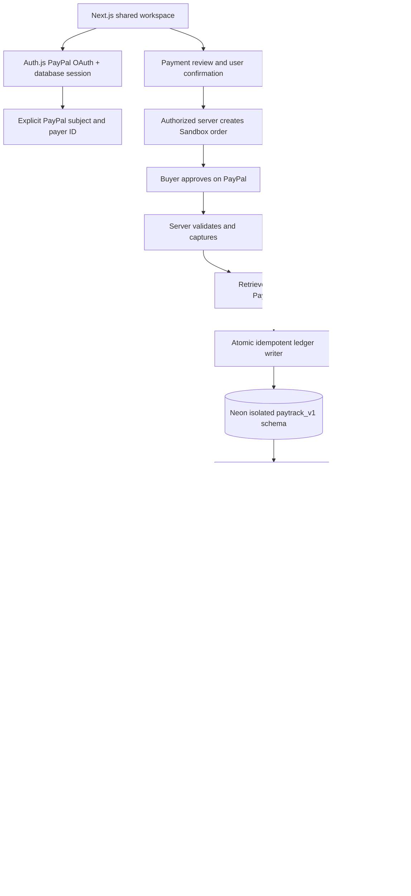

# Architecture

## Trust boundaries

OAuth links by PayPal provider subject. Checkout attribution uses only explicitly returned payer ID, never an email or assumed subject format. Every protected API derives user ID from its database session. Mutation handlers enforce same-origin requests before authorization and validation. The application accepts Sandbox only.

The model receives aggregates and allowed fact/category identifiers. It has no SQL, database credentials, identity tokens, raw financial descriptions, payment tools or budget write capability. It can select a presentation, not rewrite facts. Unknown IDs and malformed output trigger deterministic fallback.

Amounts are integer minor units. Supported currencies all have two decimal places: USD, EUR, GBP and INR. Totals never add different currencies together. UTC calendar months define reports; timestamps are displayed in the viewer's locale. A returned Checkout URL does not mark an order complete. Capture and refund amounts are verified against stored expectations before financial writes.

## Persistence and idempotency

`Payment.requestKey`, order ID and capture ID are unique. Order creation and capture send stable PayPal request IDs. Ledger uniqueness is `(userId, reference, direction)`, where reference is a verified capture or refund ID. A payment row update serializes repeated capture reconciliations. Each participant has at most one payment and one contribution. Webhook event IDs are unique, and `processedAt` is set only after financial processing succeeds. A crash before this mark safely replays reconciliation.

`User`, `Account`, `Session`, `PayPalConnection`, `Payment`, `LedgerEntry`, `Category`, `Budget`, `SplitGroup`, `Participant`, `Contribution`, `Insight`, `Notification` and `WebhookEvent` are modeled. The current copilot computes insights on demand; the Insight table is reserved and not advertised as persistent chat memory. Categories are controlled server-side checkout labels. Financial updates run in database transactions.

## Deployment

The local Node runtime supports Next.js and Prisma's Windows engine. Render's Node web service is prepared as an option; PostgreSQL stays on Neon. Stable HTTPS must precede final OAuth/webhook configuration. Secrets belong in host environment settings. No Cloudflare tunnel hostname is hardcoded. No deployment or publishing was performed.
